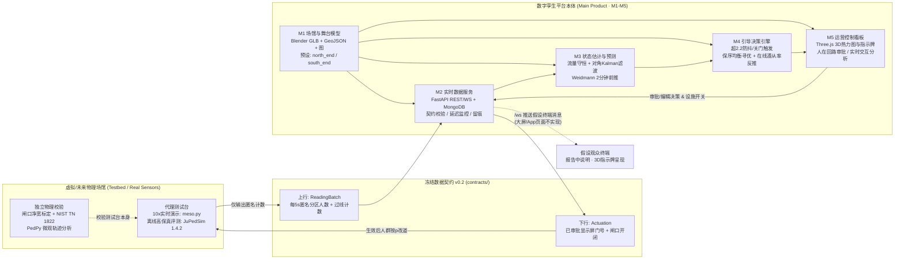

# Kai Tak Main Stadium 实时散场数字孪生：研究框架与 PRD（v1.0）

> **状态**：**已确认基线（2026-11-27 正式拍板锁定）**——已定稿 5 项核心决策：① 范围锁定西半场 51 分区 9,899 人（按 v7.5 退路汇报）；② 主线/演示默认北端舞台 `north_end`，南端 `south_end` 走 E1 敏感性对照；③ JuPedSim 仅标定闸口净宽对齐 4.16 人/s，不调时间间隙、不回调 M3/M4；④ JuPedSim 自由步速取 `1.34 × 系数`；⑤ 不实现独立 Mock 显示屏与 App 页面（按假设终端口径汇报）。  
> **文档定位**：本文件为 UGOD 6100F 团队截至 **2026-11-27** 的唯一基准研究框架与产品需求文档（Single Source of Truth），面向 **12 月 2 日代码冻结**与 **12 月 4 日最终展示**。  
> **上游依据**：[UGOD6100F_Technical_Roadmap_KaiTak_v7.5.pdf](UGOD6100F_Technical_Roadmap_KaiTak_v7.5.pdf) · [execution_plan_v0.2.md](execution_plan_v0.2.md) · [Final Presentation Rubric_v3.docx](../../Final%20Presentation%20Rubric_v3.docx) · 契约 [schemas.py](../contracts/schemas.py)（v0.2）

---

## 1. 一句话定义与范围红线（彻底隔离历史干扰）

### 1.1 产品与研究定位
**项目名称**：*Real-Time Crowd Monitoring and Guidance Digital Twin for Concert Dispersal at Kai Tak Main Stadium*  
**核心定义**：一个面向启德主场馆大型演唱会散场的**实时人群监测、2 分钟拥堵预测与人在回路动态改道数字孪生平台**。系统仅依赖每 5 秒一次的**匿名分区计数与过线流量**（零人脸/零个人隐私），在拥堵恶化前向值班经理提出可编辑的全局分流方案，审批后联动终端改道，并通过后续客流自动反推真实遵从率形成自适应闭环。

### 1.2 明确废弃或隔离的历史设计（禁止回流干扰）

> [!CAUTION]
> 以下内容属于过往迭代草稿或已明确裁撤的范围，**不再纳入当前开发与讨论**：
> 1. **室外道路封闭与社区可达性方案**（[Community_Accessibility_DT](../../03_Group_Project_KaiTak/Community_Accessibility_DT/README.md)）：已归档，仅复用其静态 HK80 坐标原点与 OSM 闸口点坐标。
> 2. **独立 Mock 导视大屏页面与 Mock 手机 App 页面**：已按 [execution_plan_v0.2.md](execution_plan_v0.2.md#L135-L141) 裁撤，报告中诚实列为假设终端（未实现页面），由 `/ws` 推送 + 3D 看板指示牌承接演示。
> 3. **全馆五层 45,000 人建模**：按 v7.5 预留的对称看台降载条款，原型范围锁定为**西半场下层看台 + 内场（2 层、51 分区、9,899 人、4 闸口 F/E/D/C）**，汇报时明示边界。
> 4. **`south_catwalk` 延伸台预设**：已核实无法在 M1 68 m 宽内场形成预期物理咽喉，取消开发。
> 5. **用 JuPedSim 场景结果反向调参 M3/M4**：严格禁止循环标定；测试台仅标定闸口净宽，孪生算法不按测试台微调。

---

## 2. 研究框架（Research Framework）

### 2.1 核心研究问题（Research Questions）

| 编号 | 研究问题 | 对应维度 | 验证方式与核心指标 |
| :--- | :--- | :--- | :--- |
| **RQ1** | 仅凭带噪的匿名分区计数与计数线流率，能否在存在**无监控盲区**与**单点摄像头断流**的情况下准确重构全场实时密度？ | **Monitoring** | 判据 (a)：监控区与盲区估计密度最大误差 ≤ 0.5 人/m²；断流 >10 s 自动标 `stale` 降级估算并恢复。 |
| **RQ2** | 在突发闸口关闭（如散场 120 s 关 Gate D）条件下，**提前 2 分钟预测 + 人在回路保序均衡改道**能在多大程度上缓解高危拥堵并缩短散场时间？ | **Prediction & Decision Support** | 判据 (b)：同随机种子下，在现实遵从率 `p ∈ [0.2, 0.8]` 区间内，T90 与超 Fruin F（2.2 人/m²）分区·秒均显著低于无引导基线；并报告提前预警命中率/误报率与峰值局限。 |
| **RQ3** | 在未知人群真实听从比例 `p` 的前提下，孪生能否仅凭下游计数线在线反推**实时遵从率**以驱动自适应闭环，并识别引导生效的最低阈值 `p`？ | **Intervention & Feedback** | 判据 (c)：报告引导有效的最低 `p`；在线遵从率估计与测试台真值偏差 < 0.1；同时在微观行人动力学（JuPedSim）下复核是否存在对向流/局部峰值等失效情形。 |
| **RQ4** | 固定场馆构造不变时，**不同场次舞台构型变化**（北端台 vs. 南端镜像台）如何重塑自然瓶颈与脆弱闸口，并影响实时改道收益？ | **Configurability & Sensitivity** | E1 敏感性实验：对比 `north_end` 与 `south_end` 下各闸口自然负荷分布、推荐关门对象、T90 及超阈值时长变化。 |

### 2.2 系统总体架构（平台与仿真：运行时强交互，工程上靠契约解耦）

> [!IMPORTANT]
> **核心架构原则**：
> 1. **运行时强双向闭环**：无论是 `meso` 还是 `JuPedSim`，每次场景实验都通过 `ReadingBatch → TwinSession (M2+M3+M4) → actuation` 与平台本体实时对话，平台绝不读取测试台内部真值（`true_counts` / `p_follow`）。
> 2. **工程上双轨解耦**：以 [schemas.py](../contracts/schemas.py)（v0.2）和 [venue.py](../contracts/venue.py) 为界，**平台主线（M1/M2/M5）**与**仿真评测线（JuPedSim/NIST/PedPy）**独立推进，互不阻塞。

---

## 3. 产品核心故事与用户场景（Product Narrative）

### 3.1 目标用户与职责
- **主用户：场馆值班经理（Duty Manager / VOC）**——在散场高压窗口内查看全场密度与 2 分钟预警，审核、局部微调并批准/驳回改道方案，必要时实时关闭或重开闸口。
- **次用户：活动策划与运维负责人（Event Ops Planner）**——开演前按当场舞台构型切换场馆配置，预判脆弱闸口与引导员布防重点。
- **间接服务对象：散场观众与现场引导员（Spectators & Stewards）**——通过环廊导视牌（及未来 App）分流避堵；轮椅及特殊需求观众由经理在审批时豁免长距离改道，并由现场引导员协助。

### 3.2 主演示剧本（《散场前的 120 秒》）
1. **赛前配置**：展示同一固定场馆架构如何通过 M1 配置适配不同场次的舞台朝向（默认 `.blend` 北端舞台，并以南端镜像台作敏感性对照说明瓶颈南北反转）。
2. **正常散场监控（0:00–2:00）**：每 5 秒刷新 51 分区密度，清晰区分实测区、无摄像头推估盲区（虚线轮廓）及 2 分钟预测曲线。
3. **突发事件与提前预警（2:00）**：Gate D 临时关闭（或演示中由经理实时点击关门），M3 提前 2 分钟预报南侧环廊将破 2.2 人/m² 红线。
4. **人在回路审批与微调**：M4 弹出量化提案（预计清空时间对比 + 遵从率假设）；经理在 3D 预览中确认影响范围，**取消勾选某一特殊照看分区**后点击 **Approve**。
5. **闭环执行与遵从率反馈**：被改道的 3D 指示牌即刻变绿并显示新目标门（如 `L2-W-D09`）；没有被改道的牌子保持默认颜色、不显示门号；只有已批准的改道消息所指的门随后被关闭时，该牌才变红警示；1 分钟后计数线反推出实测遵从率并动态修正下轮策略；最终 T90 缩短近 7 分钟、超 2.2 高危拥堵时长降 40%+。
6. **容错演示（可选加分镜头）**：触发 2 分钟摄像头断流（`C08, C10` 变灰标 `stale`），证明 M3 自动切换流量守恒估测、误差仍 ≤ 0.5 人/m²。

---

## 4. 产品需求规格（PRD · 数字孪生平台本体 M1–M5）

状态图例：**✅ 已落地验证** · **🟡 平台优化项（12/2 冻结前优先打磨，零依赖仿真）** · **🔵 计划中（见 v0.2 排期）** · **⚪ 架构预留（Future Work，不声称已实现）**

### 4.1 M1 · 空间与舞台构型模块（[m1_venue/](../m1_venue/config.yaml)）

| 需求 ID | 功能需求 | 当前状态 | 关键规格与验收标准 |
| :--- | :--- | :---: | :--- |
| **M1-01** | Blender 只读几何导出与语义分层 | ✅ | [export_blend.py](../m1_venue/export_blend.py) 导出 `venue_lite.glb`（2.4 MB，独立拆分 `stage` / `stage_screens`）、`seats.bin` 与 `geometry_ref.json`，不修改原始 `.blend`。 |
| **M1-02** | 功能层拓扑、可步行面与自动 QA | ✅ | [build_layout.py](../m1_venue/build_layout.py) 生成 51 分区、34 计数线、17 显示屏、单连通 `walkable.geojson`、`spawn.json` 与 `venue_manifest.json`；13 项 QA **0 failed**。 |
| **M1-03** | 多舞台构型预设（E1：`north_end` + `south_end`） | 🔵 | 按内场中心 `pitch_centre (189.98, -195.19)` 镜像生成 `out/presets/south_end/`（不改动默认 `out/` 基线），自动重算闭馆区（`S12–S15`）、内场出生点与 `recommended_close_gate`；两套预设 QA 全过。 |
| **M1-04** | 脱敏场次人群画像接入（按区无障碍/步速/企位先验） | ⚪ | `venue_manifest` 按区结构天然支持扩展 `zone_profile` 属性；当前原型保持全局基线人群分布，在报告中列为未来落地演进方向。 |

### 4.2 M2 · 实时数据服务与契约（[m2_service/](../m2_service/app.py) & [contracts/](../contracts/schemas.py)）

| 需求 ID | 功能需求 | 当前状态 | 关键规格与验收标准 |
| :--- | :--- | :---: | :--- |
| **M2-01** | 契约 v0.2 校验与时序持久化 | ✅ | FastAPI + MongoDB（27027）+ WebSocket `/ws`；未知 ID、无摄像头区、重复或倒序的 `seq` 拒收（422），每次拒收连同原因记入 `rejects`；非当前运行的批次、已存过的批次返回 409；独立存储 `readings / states / guidance / facility_events / evaluations / runs / rejects`。 |
| **M2-02** | 端到端低延迟与真值隔离 | ✅ | 记录每批 `latency_ms` 与 `latency_p95_ms`。MongoDB 里现有两次完整运行的 p95 分别为 6.3 ms 和 196 ms（最大 1,334 ms），差别未归因；演示前在演示机上按演示倍速实测并记录，以实测值为准；`/evaluation` 真值仅用于展示与评估，M3/M4 绝对不可见。 |
| **M2-03** | 多舞台预设加载接口（E2 可选） | 🔵 | 过关口 3 后新增 `GET /api/layouts`、`GET /api/venue?layout=` 及 `POST /api/runs` 按 `cfg.layout` 实例化 `Venue` 并落库记录。 |

### 4.3 M3 · 实时状态估计与预测（[estimator.py](../m3_state/estimator.py)）

| 需求 ID | 功能需求 | 当前状态 | 关键规格与验收标准 |
| :--- | :--- | :---: | :--- |
| **M3-01** | 盲区估计与摄像头断流容错 | ✅ | 图上流量守恒预测 + 监控区对角 Kalman 修正；4 个无监控区与断流 >10 s 标记 `stale` 分区自动保持流量估计，核心代码冻结不改。 |
| **M3-02** | 2 分钟密度前推预警 | ✅ | 基于实测离场率 + Weidmann (1993) 速度–密度公式 + 边界容量/4.0 拥堵上限/关门约束，输出各区 `forecast_density`。 |

### 4.4 M4 · 引导决策与遵从率反馈（[engine.py](../m4_guidance/engine.py)）

| 需求 ID | 功能需求 | 当前状态 | 关键规格与验收标准 |
| :--- | :--- | :---: | :--- |
| **M4-01** | 防抖触发与保序非交叉寻优 | ✅ | 连续 2 周期预测超 2.2 人/m² 或闸口关闭触发；保序切分防止环廊对冲，受 150 m 最大绕行与 30 s 最小增益约束；120 s 过期重算、60 s 冷却。 |
| **M4-02** | 人在回路编辑审批与在线遵从率闭环 | ✅ | 支持 Approve / Reject / `drop_zones` 局部删减；仅凭改道下游计数线净流量（含 30 s 沉淀窗口）最小二乘反推实时 `compliance`，反馈至下轮决策。核心代码冻结不改。 |

### 4.5 M5 · 三维运营看板（[m5_dashboard/](../m5_dashboard/index.html)）

| 需求 ID | 功能需求 | 当前状态 | 关键规格与验收标准 |
| :--- | :--- | :---: | :--- |
| **M5-01** | 3D 场馆热力图、审批面板与双语明暗主题 | ✅ | Three.js + 后处理（N8AO/Bloom/SMAA）+ 建筑剖切 + 双语 EN/ZH + 亮暗双主题 + 审批卡片/日志/评估面板 + 无头 Chrome 截图自检（[shot.mjs](../m5_dashboard/tools/shot.mjs)）。 |
| **M5-02** | **运行中手动实时开/关任意闸口** | 🟡 | 在底部 `Gates` 面板为每个闸口增加 `Close / Reopen` 按钮，直接调用已有 `PUT /api/facilities/{zone_id}`（`runner.py` 已实时回读 `act["closed"]`，零后端改动）。 |
| **M5-03** | **点击分区深度检视 + 底部曲线模式切换** | 🟡 | 支持点击 3D 分区锁定查看该区曲线，并允许底部图在「全场峰值 / 超 2.2 分区数 / 选中分区密度」间切换，消除 `T02` 顶峰造成的视觉误解；修复右轴 `10:` 标签裁切。 |
| **M5-04** | **MongoDB 历史基线同屏对照** | 🟡 | 调用已有 `GET /api/runs` 与 `/series`，支持在底部图表叠加最近一次无引导基线参考线，并在 Eval 面板显示与基线的 T90 / 超阈值时长差值。 |
| **M5-05** | **待批提案 3D 空间预演高亮** | 🟡 | 有待审批提案时，在 3D 图中以琥珀色预览高亮涉及的显示屏与上游看台区；经理取消勾选某行时对应预览同步熄灭。 |
| **M5-06** | **看板切换北/南舞台（E2 可选）** | 🔵 | 过关口 3 后落地：`overlay.js` 支持 `dispose()`，`scene.js` 把舞台、舞台屏幕和内场座椅放进一个原点在 `pitch_centre` 的组，按 M1 的 `mode: mirror` 沿南北方向缩放 −1（与 M1 的镜像一致；Three.js 在矩阵行列式为负时自动翻转正反面，不需要另外处理）。**不用绕中心旋转 180°**：那会同时翻转东西方向，3D 座椅与 M1 出生点对不上（见 [execution_plan_v0.2.md](execution_plan_v0.2.md) 1.2 节 B4、2.6.4 节）。 |
| **M5-07** | 独立观众端 Mock 显示屏 / App 页面 | ⚪ | 已裁撤为假设终端（见 1.2 节与 [execution_plan_v0.2.md](execution_plan_v0.2.md#L442-L468) 2.7 节），保留 `/ws` 扩展能力写入 Future Work。 |

---

## 5. 交互式评测与验证框架（Evaluation & Verification）

> [!NOTE]
> 本部分是对数字孪生平台本体的**黑盒压力测试与科学验证体系**，运行在独立 `.venv312` 环境，与平台本体通过契约 v0.2 实时双向交互，可按 [execution_plan_v0.2.md](execution_plan_v0.2.md) 异步推进，不阻塞平台打磨。

### 5.1 双测试台分工定位

| 测试台 | 动力学机制 | 速度 | 承担角色 |
| :--- | :--- | :---: | :--- |
| **`testbed/meso.py`（中观分区级）** | 逐人出发 + Weidmann 速度–密度 + 边界容量上限（与 M1/M3 一致） | ~2.5 s/次（可 10× 实时） | ① **12/4 现场 Live Demo 引擎**；② 35 次 `p`-sweep 基准与低 `p` / `p=0.80` 排查；③ E1 南北舞台 30 组敏感性对比。 |
| **`testbed/jps.py`（JuPedSim 1.4.2 微观）** | 二维连续空间 Collision-Free Speed Model（默认参数 + 仅标定闸口净宽对齐 4.16 人/s） | ~18–21 min/次（~1× 实时） | ① **NIST TN 1822（10 项）+ 手算验证**；② 15 次核心对照实验复核判据 (a)(b)(c)；③ **PedPy 1.5.1** 微观轨迹分析（局部 Voronoi 峰值 vs 分区均值、实测速度–密度曲线）。 |

### 5.2 当前已有基准证据（简化模型 35 次运行，Gate D 在 120 s 关闭）
- **判据 (a) 密度估计**：监控区最大误差 **0.19 人/m²**，无监控盲区最大 **0.07 人/m²**（目标 ≤ 0.5）；摄像头断流 120 s 同样 ≤ 0.5。
- **判据 (b) 引导效果**：`p = 0.20–0.80` 全部 5 个种子均优于无引导基线；`p = 0.50` 时 T90 由 **1,282 s → 874 s（-31.8%）**，超 2.2 分区·秒由 **1,891 → 1,079（-42.9%）**。
- **判据 (c) 与遵从率**：`p = 0.20` 已有效（待补测 `0.05/0.10/0.15` 找真实下限）；批量估计遵从率偏差 **≤ 0.03**。
- **已诚实识别的边界与失败案例**（直接用于 Rubric 第 15、17 项）：
  1. 引导降低的是超阈值**持续时间**，未降低 `T02/C10` 瞬时峰值（仍触及 4.0 上限）；
  2. `p = 0.80` 超阈值时长（922）反高于 `p = 0.65`（806），待归因过冲效应；
  3. 2 分钟预测命中 83%、漏报 17%、误报 13%，且中观同源预测属于技能上限；
  4. 手动审批晚于 100 s 时遵从率偏低 0.04–0.07；
  5. 几何参数为基于公开资料与 `.blend` 的 `provisional` 假设值（非实测竣工 BIM），内场通道按平地处理未含 29% 坡度减速。

---

## 6. 里程碑与 Final Presentation Rubric 20 节对齐表

### 6.1 关键时间节点（今天 2026-11-27）
- **11/28（周六）**：完成 S0 共享契约与基线回归（关口 1）；平台线启动 **M5-02~05 看板交互升级** 与 **E1 南北舞台预设**。
- **11/30（周一）**：评测线完成 JuPedSim 全员验收与 TN 1822 10 项验证（关口 2，未过则启动退路）；平台线完成 E1 30 组实验并视余力决定是否做 E2（关口 3）。
- **12/01（周二）**：完成核心实验数字定稿（关口 4）与 PedPy 分析；平台线完成新版双语/明暗 UI 截图与 Demo 流程固化。
- **12/02（周三晚）**：**全仓冻结代码**，更新 README 与实验图表，录制高清 Live Demo 兜底视频。
- **12/03（周四）**：全天合稿 Final Presentation PPT 与 2–3 轮计时彩排（含 Q&A 攻防）。
- **12/04（周五）**：正式展示与 Live Demo。

### 6.2 对齐 [Final Presentation Rubric_v3.docx](../../Final%20Presentation%20Rubric_v3.docx)（A 档检查清单）

| Rubric 编号与主题 | 本框架支撑内容与可追溯证据 | 所属轨道 |
| :--- | :--- | :---: |
| **1–4 标题/背景/痛点/目标** | 启德主场馆多舞台切换 + 传统 CCTV 事后救火痛点 + 明确 4 项 RQ 与判据 (a)–(c)。 | 共同 |
| **5–6 用例与系统架构** | 《散场前 120 秒》主剧本 + 平台/测试台契约解耦闭环架构图（虚线标出假设终端）。 | 平台主线 |
| **7–8 3D 采集与信息建模** | `.blend` + HK80 + OSM 闸口来源、QA 13 pass / 0 fail、M1 manifest 统一 ID 与 E1 舞台预设。 | 平台主线 |
| **9 多源动态数据集成** | 契约 v0.2、5 s 批处理、MongoDB 集合与索引、422/409 拒收、>10 s `stale` 断流处理、延迟 P95。 | 平台主线 |
| **10 CPS 闭环交互** | 匿名计数 → 滤波预测 → 提案审批 → 终端指示 → 计数线反推真实遵从率并修正下轮决策。 | 平台主线 |
| **11 仿真与预测建模** | Weidmann 2 分钟前推 + Meso/JuPedSim 双测试台假设对照 + 舞台构型（E1）与 `p` 敏感性分析。 | 评测线 |
| **12–13 可视化与决策支持** | 3D 双语明暗看板、运行中实时关门、单区检视、历史基线对比、3D 提案预演与局部删减审批。 | 平台主线 |
| **14 实施状态与成就** | 诚实三栏表（已落地 / 范围调整如 Mock 终端与西半场降载 / 未来扩展如非敏感人群群像与实测 BIM）。 | 共同 |
| **15 技术验证** | M1 QA、8+ 项 pytest、35 行回归、闸口标定、TN 1822 10 项、手算核对、PedPy 对齐与失败案例。 | 评测线 |
| **16 功能与应用评估** | 同随机种子基线对照（Criteria a–c）、双测试台结果并排解读、收益幅度与物理上限。 | 评测线 |
| **17 讨论局限与未来改进** | 峰值未降、预测上限、`p=0.80` 过冲、微观局部密度差异、非敏感聚合人群画像与外部港铁联动演进。 | 共同 |
| **18 分工与个人贡献** | 4 名成员（Hou/Xu/Chen/Wang）精确挂钩代码模块、Git 提交、验证与实验产出。 | 共同 |
| **19–20 现场演示与问答** | 基于 `meso` 10× 实时跑完端到端闭环（含实时关门/编辑审批/拉近绿牌/基线对比），配兜底录屏与 Q&A 备忘。 | 平台主线 |
